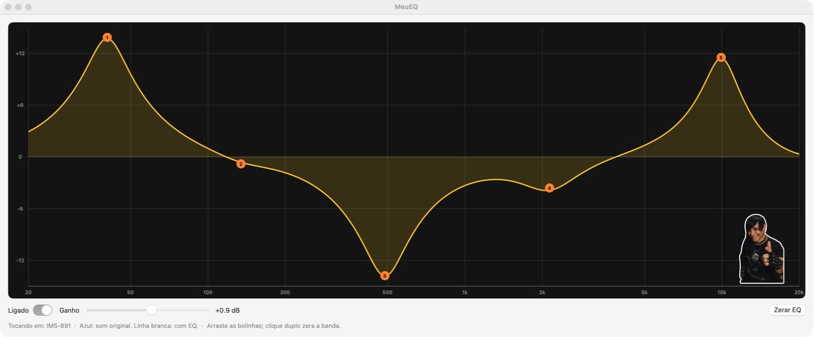

# MeuEQ

Equalizador para Mac com espectro em tempo real (RTA) desenhado atrás da curva do EQ,
no estilo da tela de EQ das mesas de som digitais. Só EQ de 5 bandas e ganho: sem
efeitos, sem driver e sem conta.

*Mac system-wide equalizer with a real-time spectrum analyzer behind the EQ curve. No driver needed.*



## Como funciona

- Captura o som de todos os apps com o recurso nativo do macOS para isso (Core Audio
  Process Tap), aplica o EQ e toca na saída de som que estiver escolhida.
- Não instala driver. Fechou o app, o som volta ao normal.
- Acompanha a troca de saída: fone, caixa, HDMI ou Bluetooth.
- O espectro azul mostra o som original, antes do EQ, para corrigir olhando as sobras. A
  linha branca mostra como ele fica com o EQ e o ganho.
- Os ajustes ficam salvos para a próxima vez.

## Requisitos

macOS 15 ou mais novo. A versão pronta para baixar é para Mac com chip Apple (M1 ou mais
novo).

## Como instalar, passo a passo

Leva uns dois minutos. Não precisa instalar mais nada.

1. **Confira o seu Mac.** No menu da Apple, abra **Sobre Este Mac**. O chip precisa ser
   Apple (M1 ou mais novo) e o macOS, 15 ou mais novo. Mac com processador Intel não roda
   esta versão.
2. **Baixe o app:** [clique aqui para baixar o MeuEQ.zip](https://github.com/tuliomota1989/meu-eq/releases/latest/download/MeuEQ.zip).
3. **Descompacte.** Na pasta Downloads, clique duas vezes em `MeuEQ.zip`. Vai aparecer o
   `MeuEQ.app`.
4. **Arraste o `MeuEQ.app` para a pasta Aplicativos.**
5. **Tente abrir.** Clique duas vezes no MeuEQ, dentro de Aplicativos. O macOS vai
   bloquear, porque o app não é assinado por um desenvolvedor registrado na Apple. Isso é
   esperado na primeira vez: feche o aviso, sem mover o app para o Lixo.
6. **Libere o app.** Abra **Ajustes do Sistema › Privacidade e Segurança**, role até a parte
   de **Segurança**, clique em **Abrir Mesmo Assim** ao lado do MeuEQ e confirme com a sua
   senha.
7. **Aceite a permissão de áudio.** Quando o app pedir para gravar o áudio do sistema,
   permita. É ela que deixa o app receber o som para equalizar.

Pronto. Coloque uma música para tocar e a onda azul aparece no gráfico.

### Se algo der errado

- **O app abriu, mas não aparece a onda ou o EQ não muda o som:** abra **Ajustes do Sistema
  › Privacidade e Segurança › Gravação de Tela e Áudio do Sistema**, ligue o MeuEQ, feche o
  app e abra de novo.
- **Quero o som normal de volta:** é só fechar o MeuEQ.
- **Quero desinstalar:** feche o app e mande o `MeuEQ.app` para o Lixo.

## Compilar

Precisa só das Command Line Tools (`xcode-select --install`), sem o Xcode:

```bash
./build.sh
open MeuEQ.app
```

Para conferir a matemática do EQ e do analisador:

```bash
.build/release/MeuEQ --selftest
```

## Usar

- Arraste as bolinhas: para os lados escolhe a frequência, para cima e para baixo muda o
  ganho da banda.
- Clique duplo numa bolinha zera a banda.
- **Ganho** muda o volume geral (de -12 a +12 dB). **Ligado** compara o som com e sem EQ.

## Licença

MIT. Veja [LICENSE](LICENSE).
