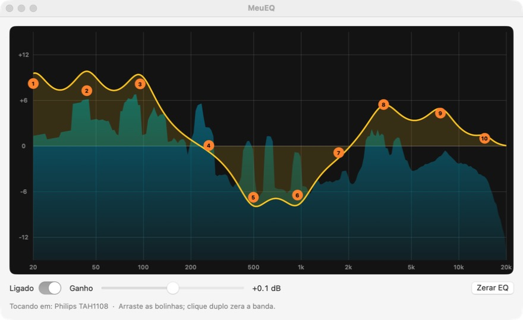

# MeuEQ

Equalizador para Mac com espectro em tempo real (RTA) desenhado atrás da curva do EQ,
no estilo da tela de EQ das mesas de som digitais. Só EQ de 10 bandas e ganho: sem
efeitos, sem driver e sem conta.

*Mac system-wide equalizer with a real-time spectrum analyzer behind the EQ curve. No driver needed.*



## Como funciona

- Captura o som de todos os apps com o recurso nativo do macOS para isso (Core Audio
  Process Tap), aplica o EQ e toca na saída de som que estiver escolhida.
- Não instala driver. Fechou o app, o som volta ao normal.
- Acompanha a troca de saída: fone, caixa, HDMI ou Bluetooth.
- O espectro mostra o som depois do EQ, ou seja, o que você está ouvindo.
- Os ajustes ficam salvos para a próxima vez.

## Requisitos

macOS 15 ou mais novo. A versão pronta para baixar é para Mac com chip Apple (M1 ou mais
novo).

## Instalar a versão pronta

1. Baixe o `MeuEQ.zip` em [Releases](../../releases) e descompacte.
2. Arraste o `MeuEQ.app` para a pasta Aplicativos.
3. Na primeira vez, o macOS bloqueia a abertura, porque o app não é assinado por um
   desenvolvedor registrado na Apple. Abra **Ajustes do Sistema › Privacidade e
   Segurança** e clique em **Abrir Mesmo Assim**.
4. Aceite a permissão para gravar o áudio do sistema. É ela que deixa o app equalizar.

## Compilar

Precisa só das Command Line Tools (`xcode-select --install`), sem o Xcode:

```bash
./build.sh
open MeuEQ.app
```

Para conferir a matemática do EQ e do analisador:

```bash
.build/release/MeuEQ --selftest
```

## Usar

- Arraste as bolinhas: para os lados escolhe a frequência, para cima e para baixo muda o
  ganho da banda.
- Clique duplo numa bolinha zera a banda.
- **Ganho** muda o volume geral (de -12 a +12 dB). **Ligado** compara o som com e sem EQ.

## Licença

MIT. Veja [LICENSE](LICENSE).
